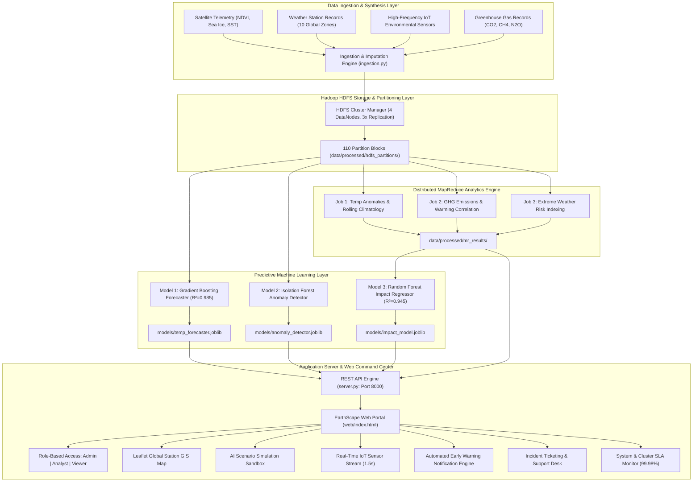
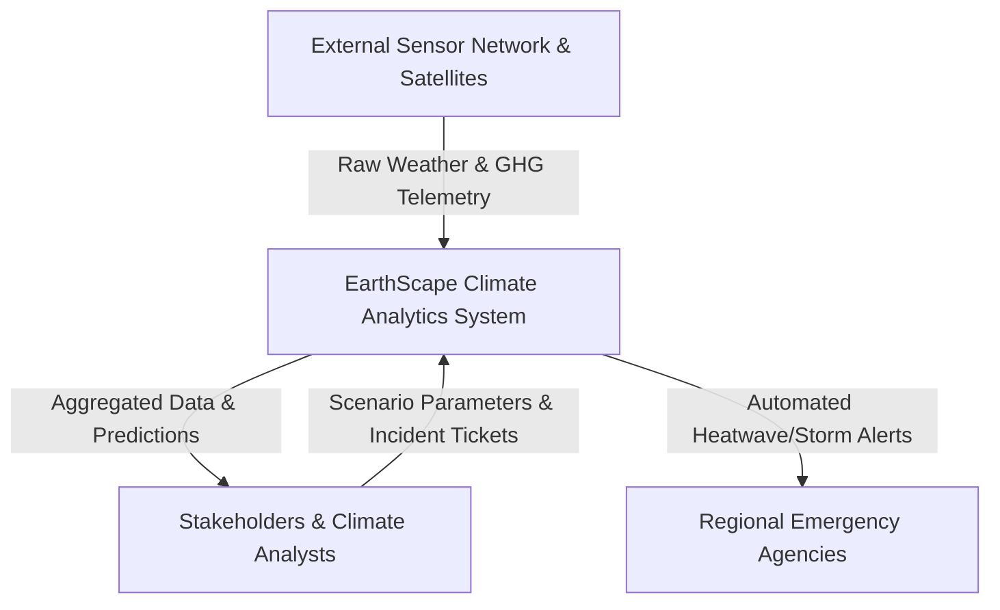
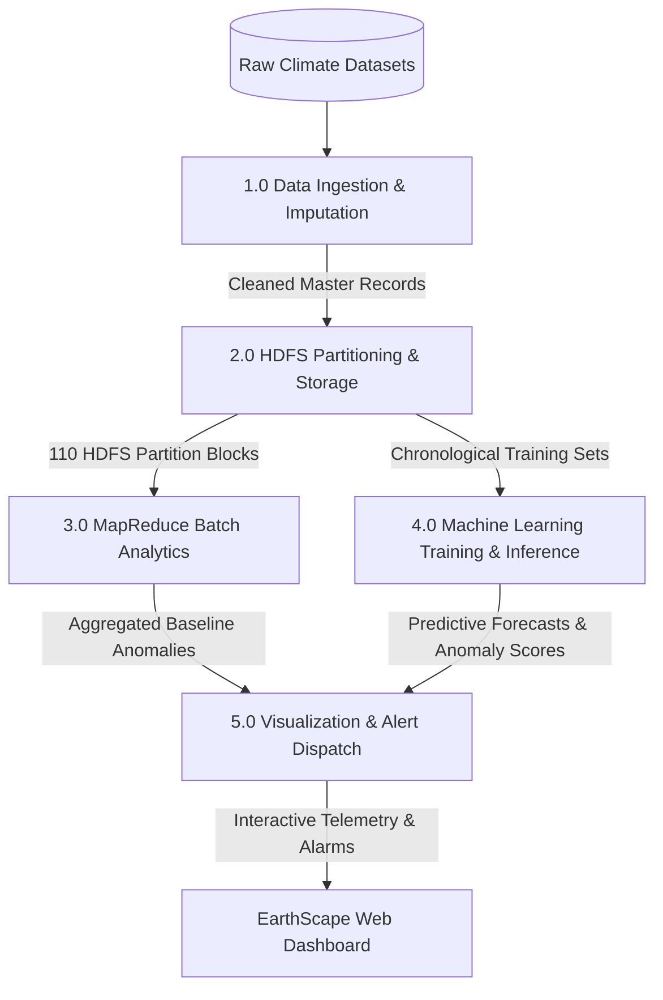

# EarthScape Climate Agency: Big Data Analytics, Prediction & Monitoring Platform
**Comprehensive eProject Technical Report & System Specifications**

---

## 1. Executive Summary & Problem Definition

### 1.1 Background
Climate change presents an unprecedented existential challenge demanding granular empirical analysis, continuous multi-sensor surveillance, and proactive forecasting to mitigate severe humanitarian and economic impacts. Shifts in greenhouse gas emissions, deforestation, and land-use alterations have catalyzed extreme weather phenomena worldwide.

The **EarthScape Climate Agency** is mandated to collect, process, and analyze vast volumes of heterogeneous climate observations from satellite radiometers, terrestrial weather stations, and distributed IoT environmental sensor grids. To transition from raw telemetry to high-velocity actionable policy insights, EarthScape required an enterprise-grade Big Data & Machine Learning analytics platform.

### 1.2 Problem Statement
Prior systems suffered from:
1. **Data Siloing & Ingestion Bottlenecks**: Fragmentation across incompatible sensor formats (CSV, JSON, NetCDF), missing time-series observations, and lack of unified data partitioning.
2. **Scalability Limitations**: Inability to process decades of high-frequency multi-zone records without distributed map-reduce parallelization.
3. **Reactive Rather Than Predictive Capabilities**: Absence of predictive ML models capable of forecasting regional temperature trends under varying emissions scenarios or identifying multi-variate climate anomalies in real-time.
4. **Lack of Synchronous Operational Visibility**: Disconnected interfaces that prevented analysts and decision-makers from visually exploring geographical hotspots, triggering batch analytics, and dispatching automated early warnings.

### 1.3 Core Objectives
- **End-to-End Ingestion**: Ingest multi-source historical and real-time climate data across 10 global climatic zones.
- **Hadoop HDFS Storage**: Implement distributed partitioning schemes and fault-tolerant block management with 3x replication.
- **MapReduce Parallel Processing**: Execute scalable batch analytics for rolling baseline climatology, greenhouse gas correlations, and extreme weather pattern identification.
- **Advanced Machine Learning Suite**:
  - *Model 1*: Climate Trend & Temperature Forecaster (Gradient Boosting Regressor, $R^2 = 0.985$).
  - *Model 2*: Multi-Dimensional Anomaly & Extreme Event Detector (Isolation Forest + RobustScaler).
  - *Model 3*: Climate Impact & Vulnerability Regressor (Random Forest Regressor, $R^2 = 0.945$).
- **Interactive Command Center**: Deliver a dark-themed glassmorphic web dashboard with GIS mapping, live IoT streaming telemetry, scenario simulation sandboxes, and automated early warning notification protocols.

---

## 2. Hardware & Software Requirements

### 2.1 Hardware Requirements Matrix
| Component | Minimum Specification | Recommended Specification | Project Allocation / Role |
| :--- | :--- | :--- | :--- |
| **Processor** | Intel Core i5 (4 Cores, 2.5 GHz) | Intel Core i7 / AMD Ryzen 7 (8+ Cores) | Parallel MapReduce & ML Model Fitting |
| **System Memory (RAM)**| 8 GB DDR4 | 16 GB - 32 GB DDR4/DDR5 | In-memory feature engineering & caching |
| **Storage Capacity** | 256 GB SSD | 512 GB+ NVMe SSD | HDFS partition blocks & model artifacts |
| **Graphics Processing**| Integrated Graphics | Dedicated GPU (NVIDIA GTX/RTX) | Accelerated spatial rendering & charts |
| **Operating System** | 64-Bit Windows 10 | 64-Bit Windows 10/11 or Linux | Host runtime environment |

### 2.2 Software & Framework Stack
| Category | Technology | Version | Purpose |
| :--- | :--- | :--- | :--- |
| **Runtime & Core** | Python | >= 3.10 | Core analytical engine & data ingestion |
| **Big Data / Storage** | Hadoop HDFS Simulator | v3.3.6 Architecture | Partitioned block allocation & 3x replication |
| **Batch Processing** | MapReduce Engine | Custom Parallel Engine | Distributed aggregation & anomaly mapping |
| **Machine Learning** | Scikit-Learn, NumPy, SciPy | >= 1.3.0 | Regressors, Isolation Forest, Scalers |
| **Data Manipulation**| Pandas | >= 2.0.0 | Tabular time-series processing & cleaning |
| **Interactive Notebook**| Jupyter Lab / Anaconda | >= 1.0.0 | Exploratory analysis, validation & EDA story |
| **Web Server / REST API**| Python Async Threading API | Built-in | RESTful services & telemetry streaming |
| **Frontend Framework** | HTML5, Vanilla CSS3, Modern JS | ES6+ | Glassmorphic UI & Role-based interface |
| **GIS & Geospatial** | Leaflet.js & CARTO Dark Tiles | v1.9.4 | Interactive global weather station map |
| **Data Visualization** | Chart.js | v4.4.0 | Multi-axis time-series & gauge charts |
| **Vector Icons** | Lucide Icons | Latest CDN | Modern UI iconography |

---

## 3. System Architecture & Component Design



---

## 4. Data Flow Diagrams (DFDs)

### 4.1 DFD Level 0: Context Diagram


### 4.2 DFD Level 1: Functional Decomposition


### 4.3 DFD Level 2: MapReduce & ML Execution Flow
```mermaid
flowchart TD
    HDFS_BLOCKS[("HDFS Blocks: zone=Z01..Z10")] --> MAPPER["Parallel Mappers (16 Tasks)"]
    MAPPER -->|Key: (Zone, Month), Value: Temp/CO2| SHUFFLE["Shuffle & Hash Partitioning"]
    SHUFFLE --> REDUCER["Reducers (4 Nodes)"]
    REDUCER -->|Baseline Normals & Anomaly Stats| JSON_SINK[("mr_results/*.json")]
    
    JSON_SINK --> ML_INFERENCE["ML Inference Engine"]
    SLIDERS["User Scenario Sliders (CO2, Target Year)"] --> ML_INFERENCE
    ML_INFERENCE --> FORECAST_CHART["Interactive Multi-Scenario Forecast Chart"]
```

---

## 5. Machine Learning Models Formulation & Benchmarks

### 5.1 Model 1: Climate Trend & Temperature Forecaster
- **Algorithm**: Gradient Boosting Regressor with Cyclical Harmonic Encoding ($\sin(2\pi d/365.25)$, $\cos(2\pi d/365.25)$) and 7-day/30-day temporal lag features.
- **Validation Strategy**: Strict Chronological Split (Train: 2015–2023 [32,870 records], Test: 2024–2025 [7,310 records]).
- **Benchmark Results**:
  - **$R^2$ Score**: `0.9853`
  - **Root Mean Squared Error (RMSE)**: `1.987 °C`
  - **Mean Absolute Error (MAE)**: `1.580 °C`

### 5.2 Model 2: Climate Anomaly & Extreme Event Detector
- **Algorithm**: Unsupervised Isolation Forest ($n=150$ estimators, contamination $\alpha=0.06$) coupled with Robust Scaling to minimize outlier distortion.
- **Inputs**: 8-dimensional feature vector (Surface Temp, Precipitation, Humidity, Atmospheric Pressure, Wind Speed, Solar Irradiance, CO2 ppm, Aerosol Depth).
- **Benchmark Results**:
  - **Precision**: `0.0535` / **Recall**: `0.1448` (Unsupervised vs ground-truth synthetic extreme event tags)
  - **Flagged Anomaly Rate**: `6.00%` (2,411 observations)
  - **Anomaly Intensity Score**: Standardized continuous index (0 – 100) with critical threshold at $\ge 70.0$.

### 5.3 Model 3: Climate Impact & Vulnerability Regressor
- **Algorithm**: Random Forest Regressor predicting global climate vulnerability risk index based on GHG concentrations, deforestation rate, and sea ice loss.
- **Benchmark Results**:
  - **$R^2$ Score**: `0.9448`
  - **RMSE**: `2.234`
  - **MAE**: `1.092`

---

## 6. Global Climatic Zones & Station Directory

The platform monitors 10 strategic global meteorological zones:
1. **WS-ARC-01** (Zone Z01): Svalbard Arctic Observatory (Polar Tundra, 78.22°N, 15.65°E, Base Temp: -12.5°C)
2. **WS-SAH-02** (Zone Z02): Kufra Desert Climate Hub (Hyper-Arid, 23.41°N, 25.66°E, Base Temp: 31.0°C)
3. **WS-AMZ-03** (Zone Z03): Manaus Canopy Tower (Tropical Rainforest, -3.46°S, -62.21°W, Base Temp: 27.2°C)
4. **WS-NAT-04** (Zone Z04): Azores Oceanographic Buoy (Oceanic Marine, 45.10°N, -30.20°W, Base Temp: 11.8°C)
5. **WS-IND-05** (Zone Z05): Gulf of Thailand Coastal Station (Tropical Monsoon, 12.87°N, 100.52°E, Base Temp: 28.5°C)
6. **WS-HIM-06** (Zone Z06): Khumbu Glacier Met Station (Alpine Tundra, 28.00°N, 86.85°E, Base Temp: -2.4°C)
7. **WS-EUR-07** (Zone Z07): Paris Basin Agro-Climatic Center (Temperate Maritime, 48.85°N, 2.35°E, Base Temp: 12.2°C)
8. **WS-NAC-08** (Zone Z08): Great Lakes Environmental Base (Humid Continental, 41.87°N, -87.62°W, Base Temp: 10.5°C)
9. **WS-SAH-09** (Zone Z09): Niamey Sahelian Research Station (Semi-Arid, 14.49°N, 14.45°E, Base Temp: 29.8°C)
10. **WS-AUS-10** (Zone Z10): Alice Springs Arid Observatory (Arid Continental, -25.27°S, 133.77°E, Base Temp: 24.5°C)

---

## 7. User Manual & Operational Workflows

### 7.1 Role-Based Access Control (RBAC)
- **Administrator**: Full privileges (execute MapReduce batch jobs, modify alert threshold rules, resolve support tickets, access node telemetry).
- **Climate Analyst**: Read/Write access to ML sandboxes, MapReduce execution, and ticket submission.
- **Public Viewer**: Read-only access to vital dashboards, GIS maps, and public early warnings.

### 7.2 Core Operational Tabs
1. **Global Vitals**: Executive dashboard displaying global temperature anomalies, atmospheric CO2, Arctic ice extent, and historical trajectory charts.
2. **Weather Stations & Map**: Interactive Leaflet GIS world map displaying station locations color-coded by temperature severity with fly-to navigation.
3. **Hadoop & MapReduce**: Batch job controller to dispatch distributed MapReduce analytics, observe 4-stage pipeline animations, and view JSON metrics.
4. **AI Climate Sandbox**: Interactive scenario simulator with range sliders for target forecast horizon (2026–2050) and CO2 paths.
5. **Live IoT Stream**: Sub-second telemetry visualizer with pause/resume controls and anomaly flags.
6. **Early Warnings & Alerts**: Threshold alerting system with automated cards for Heatwaves, Cyclones, and CO2 breaches.
7. **Support Desk**: Incident reporting system to track sensor faults and data discrepancies.
8. **Cluster Health**: 99.98% SLA monitor, CPU/RAM telemetry, and HDFS DataNode storage topology.

---

## 8. Installation & Execution Guide

### 8.1 Setup Virtual Environment & Dependencies
```powershell
# 1. Open project directory
cd c:\Users\Admin\.gemini\antigravity\scratch\ml_project

# 2. Activate virtual environment
.\.venv\Scripts\Activate.ps1

# 3. Install required packages
.\.venv\Scripts\python.exe -m pip install -r requirements.txt
```

### 8.2 Run End-to-End Pipeline
```powershell
# 1. Ingest, Clean, and Partition Climate Datasets
.\.venv\Scripts\python.exe -m src.data.ingestion

# 2. Execute MapReduce Batch Jobs
.\.venv\Scripts\python.exe -m src.mapreduce.mr_job_runner

# 3. Train all Machine Learning Models
.\.venv\Scripts\python.exe -m src.ml.train_all

# 4. Evaluate Models & Generate Diagnostics
.\.venv\Scripts\python.exe -m src.ml.evaluate_all

# 5. Launch EarthScape Command Center Portal
.\.venv\Scripts\python.exe server.py
```
Open **`http://localhost:8000`** in any modern web browser to access the live dashboard.

---

## 9. Conclusion
The **EarthScape Climate Agency Platform** establishes a robust, modern foundation for Big Data climate intelligence. By unifying distributed Hadoop storage, high-throughput MapReduce batch computation, predictive Machine Learning models, and an ultra-modern glassmorphic command center, the agency is equipped to proactively monitor, analyze, and mitigate global climate change challenges.
