<h1 align="center">🌍 EarthScape — Climate Big Data &amp; ML Platform</h1>

<p align="center">
  A full-stack climate analytics platform built in Python:<br/>
  <b>Data ingestion → HDFS-style partitioning → MapReduce jobs → 3 ML models → REST API → interactive dashboard</b>
</p>

<p align="center">
  
  
  
  
  
  
</p>

<p align="center">
  <a href="#-screenshots">Screenshots</a> ·
  <a href="#-machine-learning-results">ML results</a> ·
  <a href="#-architecture">Architecture</a> ·
  <a href="#-run-it-locally">Run locally</a>
</p>

<p align="center">
  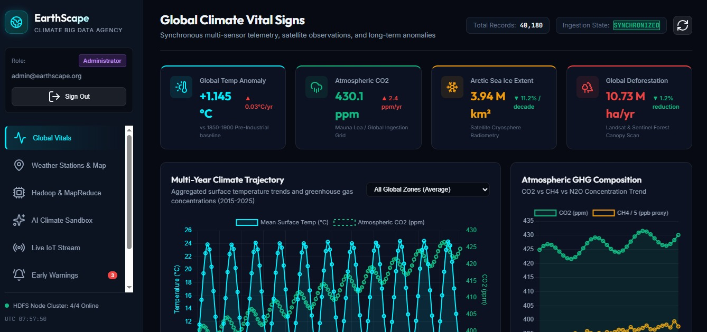
</p>

---

## 📌 The problem

A climate agency collects data from weather stations, greenhouse-gas inventories and IoT sensors across
very different regions. Analysts need one place to **store it at scale, run batch analytics, forecast
temperatures, flag anomalies and get early warnings**, with access restricted by role.

**EarthScape** builds that platform end to end and demonstrates the core ideas of a big-data system
(partitioned storage, replication, MapReduce) together with a working ML layer and a secure web dashboard.

## 🔢 At a glance

| | |
|---|---|
| 📅 **40,180** daily climate records | 10 climate zones × 11 years (2015–2025) |
| 🗂️ **110** HDFS partitions | partitioned by zone and year, 4 simulated DataNodes, 3× replication |
| ⚙️ **3** MapReduce jobs | temperature anomalies, GHG–warming correlation, extreme events |
| 🤖 **3** ML models | temperature forecasting, anomaly detection, climate-risk scoring |
| 🌐 **20+** REST endpoints | data, MapReduce, predictions, alerts, tickets, auth |
| 🔐 **2** roles | Administrator and Climate Analyst, bcrypt-hashed passwords |

> **About the data:** the climate dataset is **synthetic**, generated by [`src/data/generator.py`](src/data/generator.py)
> with realistic seasonality, regional warming trends, injected extreme events and sensor noise.
> This makes the pipeline fully reproducible (fixed seed) without depending on an external data source.

## 📸 Screenshots

| Climate dashboard | Weather-station map |
|---|---|
|  | 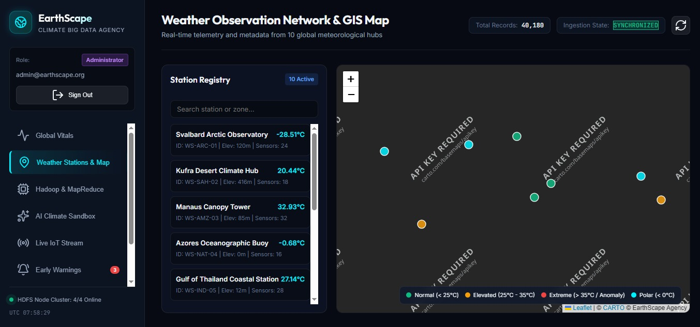 |
| **MapReduce job monitor** | **Temperature forecast (ML)** |
|  | 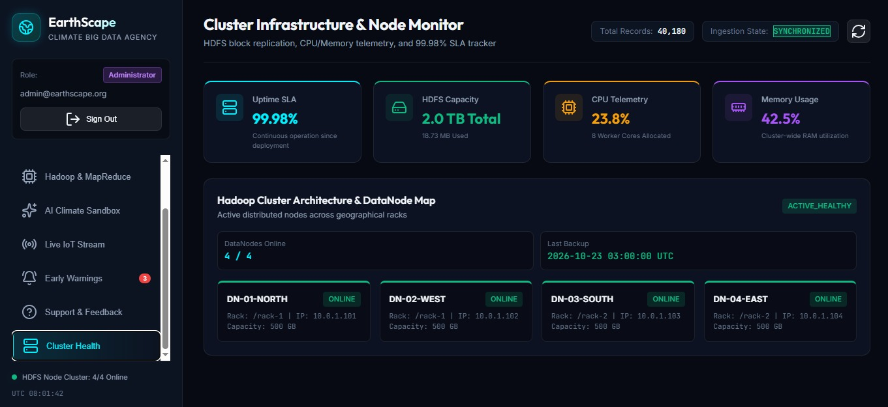 |
| **Anomaly detection (ML)** | **Climate-risk prediction (ML)** |
| 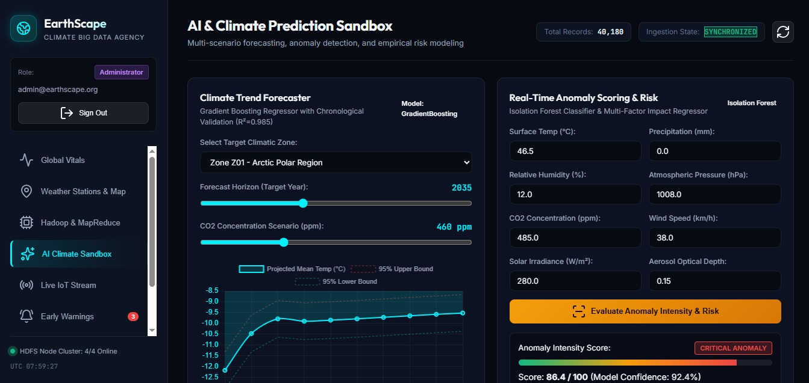 |  |
| **Live IoT telemetry** | **Early-warning alerts** |
| 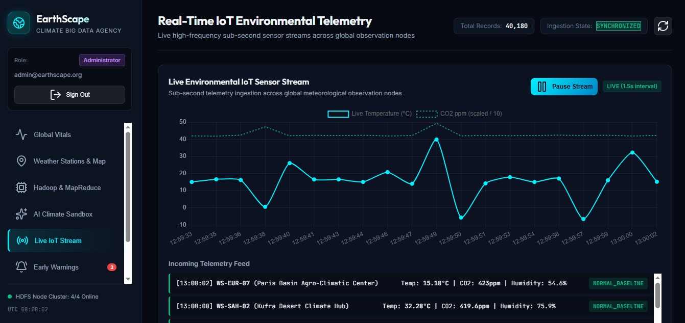 | 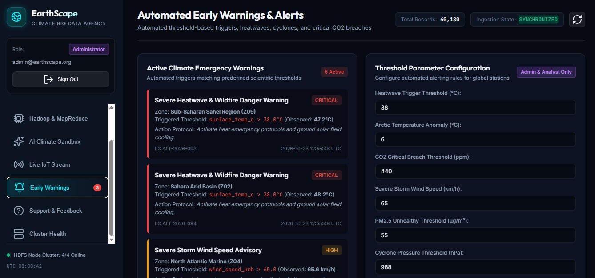 |
| **Cluster health** | **Login (role-based access)** |
| 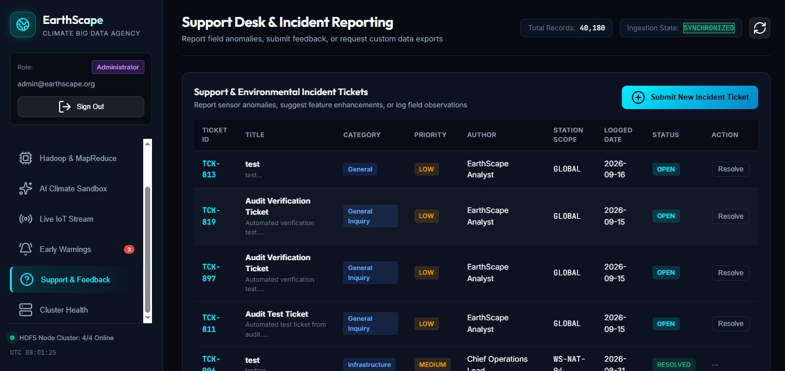 | 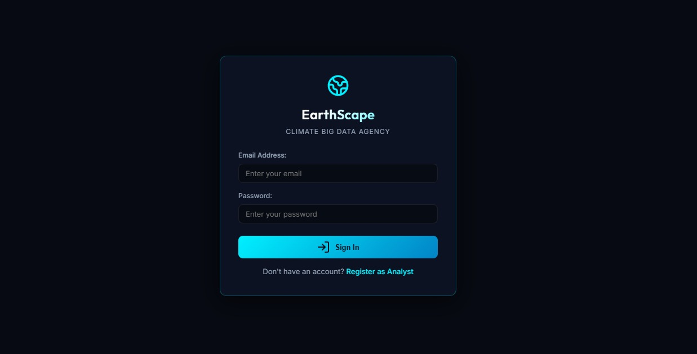 |

## 🤖 Machine learning results

All models are scikit-learn pipelines saved with `joblib`. The forecaster uses a **chronological split**
(train 2015–2023, test 2024–2025), so it is evaluated on future data it has never seen.

| Model | Task | Result |
|---|---|---|
| **Gradient Boosting Regressor** | Daily temperature forecasting | **R² 0.985**, RMSE 1.99 °C, MAE 1.58 °C (7,310 test days) |
| **Random Forest Regressor** | Climate Vulnerability Risk Index (0–100) | **R² 0.956**, RMSE 1.98, MAE 0.97 |
| **Isolation Forest + RobustScaler** | Unsupervised anomaly detection | Flags 6% of observations; precision 5.4%, recall 14.5% vs injected extreme events |

**Feature engineering:** long-term trend index, harmonic (sin/cos) seasonal features, 7- and 30-day temperature lags
and a 30-day rolling mean per zone, greenhouse-gas and aerosol readings, and an encoded climate zone.

**Honest note on the anomaly detector:** Isolation Forest is unsupervised and finds *statistically unusual*
readings, which is not the same thing as the labelled extreme events. Its low precision shows this gap clearly.
Next steps would be zone-specific models, tuning `contamination`, or a supervised classifier now that labels exist.

Full metrics: [`models/models_evaluation_summary.json`](models/models_evaluation_summary.json) ·
EDA and modelling notebook: [`notebooks/01_climate_bigdata_eda_ml.ipynb`](notebooks/01_climate_bigdata_eda_ml.ipynb)

## 🏗️ Architecture

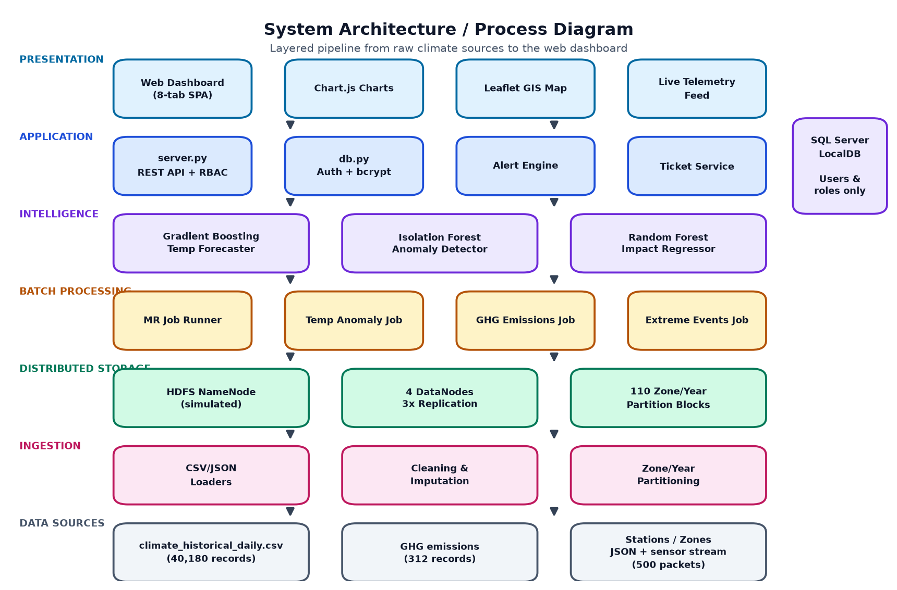

<details>
<summary><b>More diagrams</b> (data flow, database, flowcharts)</summary>

| Data flow (level 1) | Database design |
|---|---|
| 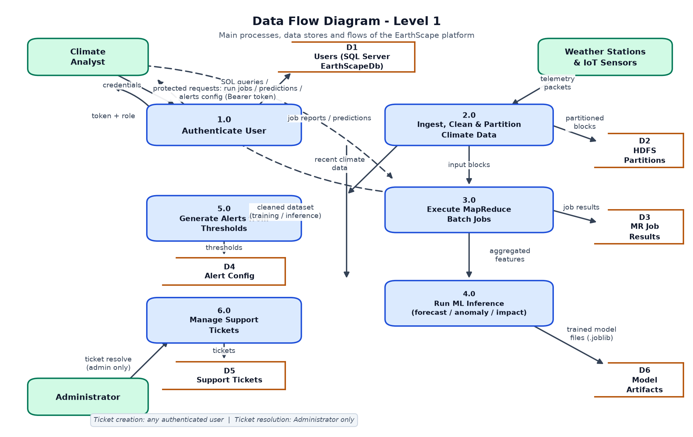 | 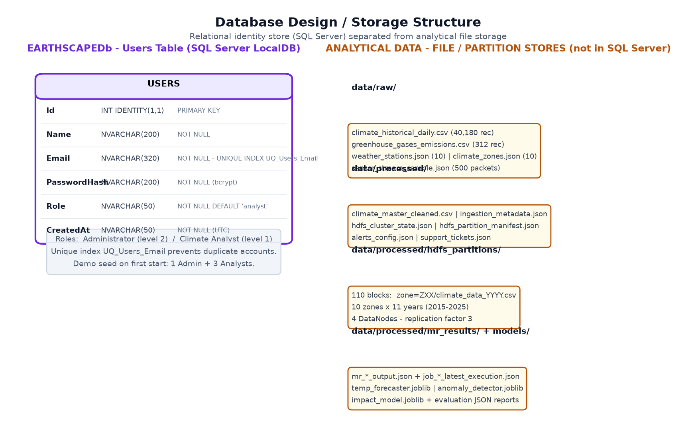 |
| **Data pipeline** | **MapReduce flow** |
| 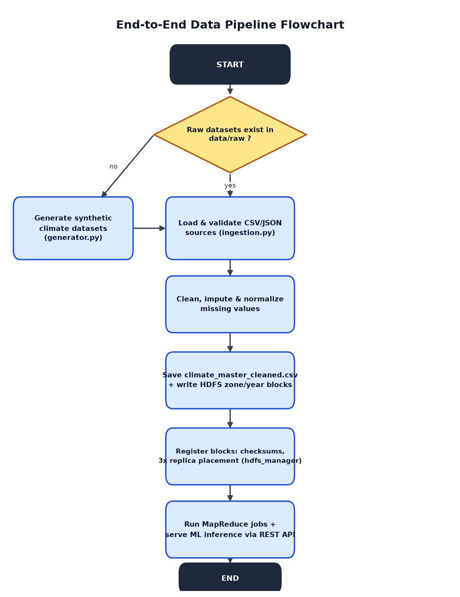 | 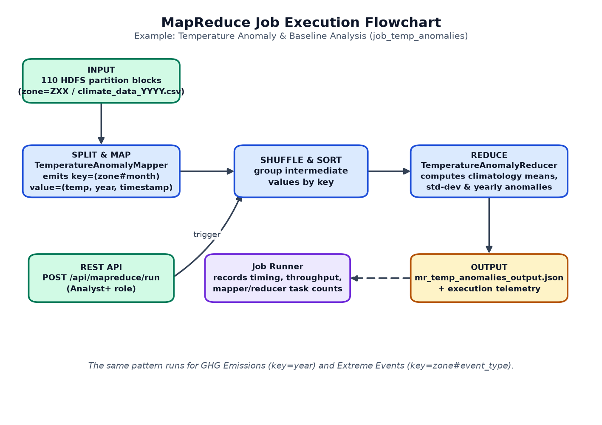 |
| **Authentication** | **Alerts** |
| 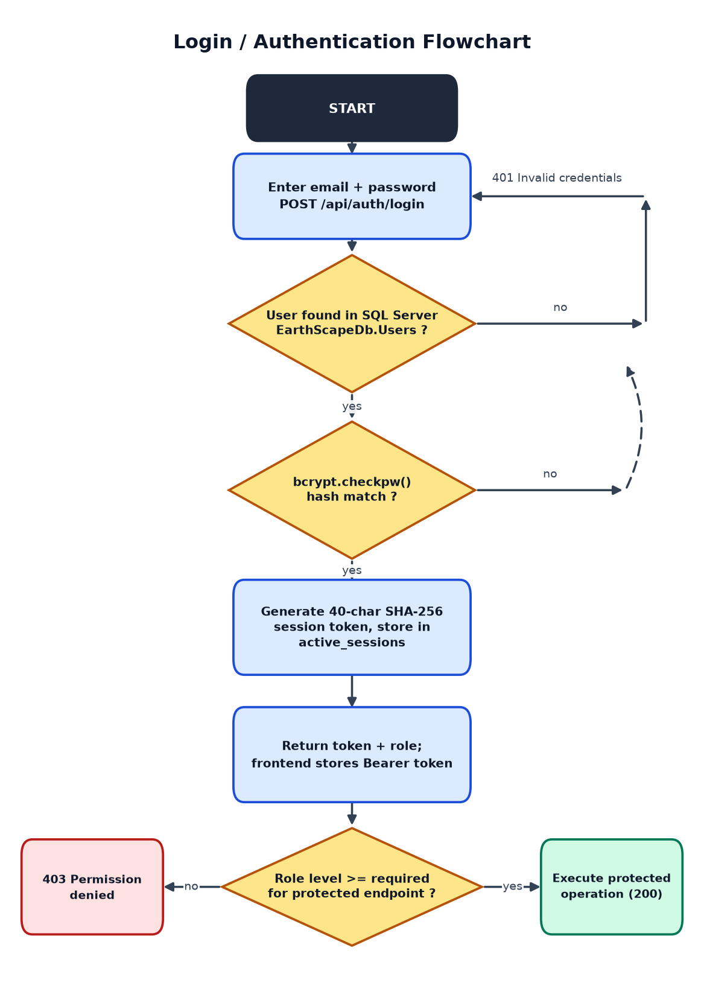 | 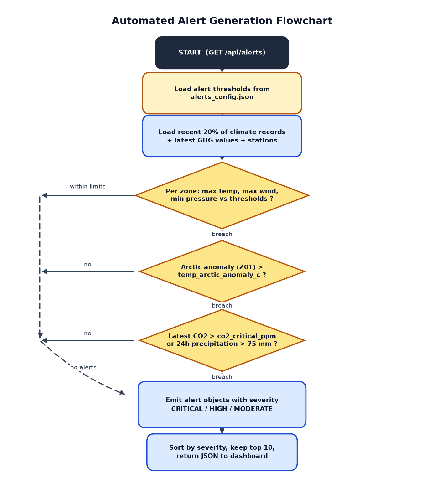 |

</details>

## ⚙️ What's under the hood

**Data ingestion** ([`src/data/`](src/data))
- Loads CSV and JSON sources: daily climate observations, GHG emissions, station metadata, IoT sensor stream
- Cleans the data and fills gaps with per-zone linear interpolation, then partitions it by `zone=Zxx/year`

**HDFS simulation** ([`src/hadoop/hdfs_manager.py`](src/hadoop/hdfs_manager.py))
- NameNode metadata, 4 DataNodes, block placement with 3× replication, cluster health reporting
- Shows how HDFS storage works without needing a real Hadoop cluster

**MapReduce jobs** ([`src/mapreduce/`](src/mapreduce))
- Real `map` → shuffle → `reduce` phases written in Python
- **Temperature anomalies:** monthly climatological baseline (mean and std) per zone, anomaly for every record
- **GHG emissions:** regional emissions and deforestation, and their correlation with surface warming
- **Extreme events:** heatwaves, severe storms and droughts, with a severity score per event
- Job runner records execution time, input/output counts and results

**Web application** ([`server.py`](server.py), [`web/`](web))
- REST API built on Python's `http.server` (no framework), serving JSON and the single-page dashboard
- Session-token authentication, **bcrypt** password hashing, role hierarchy enforced on protected endpoints
- User accounts stored in **SQL Server LocalDB** via `pyodbc` (database created automatically on first run)
- Dashboard in vanilla JavaScript with **Chart.js** charts and a **Leaflet** map: KPIs, station map,
  MapReduce triggers, ML prediction sandbox, live telemetry, configurable alerts, support tickets, cluster health

## 🧰 Tech stack

| Layer | Tools |
|---|---|
| Data processing | Python, pandas, NumPy |
| Big data concepts | HDFS-style partitioning and replication, MapReduce (implemented in Python) |
| Machine learning | scikit-learn (Gradient Boosting, Random Forest, Isolation Forest), joblib |
| Backend | Python `http.server`, REST API, bcrypt, pyodbc |
| Database | SQL Server LocalDB |
| Frontend | HTML, CSS, JavaScript, Chart.js, Leaflet.js |
| Analysis | Jupyter Notebook, matplotlib, seaborn |

## 📁 Project structure

```
├── data/
│   ├── raw/                 # climate, GHG, stations, zones, sensor stream
│   └── processed/           # generated: cleaned data, HDFS partitions, MapReduce output
├── models/                  # generated: trained models + evaluation reports
├── notebooks/               # EDA and modelling notebook
├── src/
│   ├── data/                # generator, ingestion, static reference data
│   ├── hadoop/              # HDFS cluster simulation
│   ├── mapreduce/           # 3 MapReduce jobs + job runner
│   └── ml/                  # model training and evaluation
├── web/                     # dashboard (index.html, app.js, styles.css)
├── docs_assets/             # screenshots and diagrams
├── server.py                # REST API + web server
├── db.py                    # SQL Server LocalDB, users, bcrypt
└── requirements.txt
```

## 🚀 Run it locally

**Requirements:** Windows, Python 3.10+, SQL Server LocalDB (comes with Visual Studio), ODBC Driver 18 for SQL Server.

```powershell
git clone https://github.com/HafizaMaryam25/Earth_Scape.git
cd REPO_NAME
python -m venv .venv
.venv\Scripts\activate
pip install -r requirements.txt
copy .env.example .env

python -m src.data.ingestion          # clean + partition the data
python -m src.mapreduce.mr_job_runner # run the MapReduce jobs
python -m src.ml.train_all            # train the 3 models
python -m src.ml.evaluate_all         # write evaluation reports
python server.py                      # start the app
```

Open **http://localhost:8000**. Demo accounts (1 Administrator, 3 Analysts) are created automatically on first start.
You can also register a new account from the login page.

## 🧭 Limitations and next steps

- Data is synthetic; the next step is to plug in real sources such as NOAA or ERA5 reanalysis data.
- HDFS and MapReduce are simulated in Python to show the concepts; a production version would run on Hadoop or Spark.
- Sessions are kept in memory and reset when the server restarts.
- Testing is currently manual; adding `pytest` tests for the MapReduce jobs and API is planned.

## 👤 Author

**Hafiza Maryam ** · [LinkedIn](https://www.linkedin.com/in/hafizamaryam/) · [GitHub](https://github.com/HafizaMaryam25)

*Open to Data Analyst / Data Science roles.*
